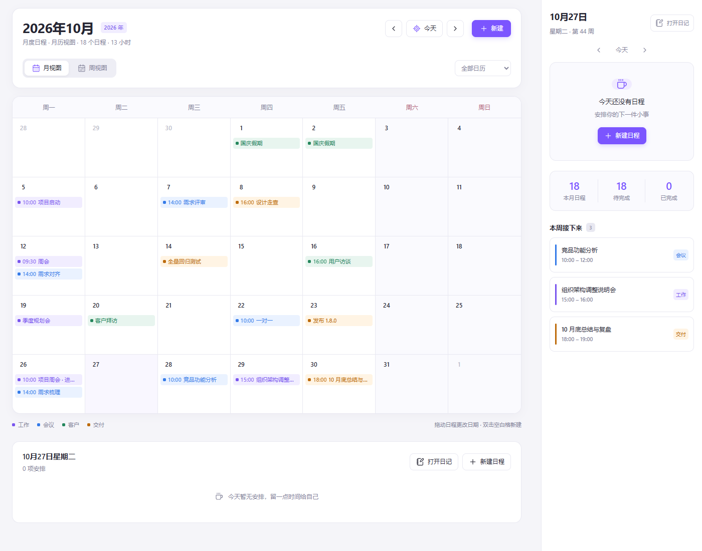
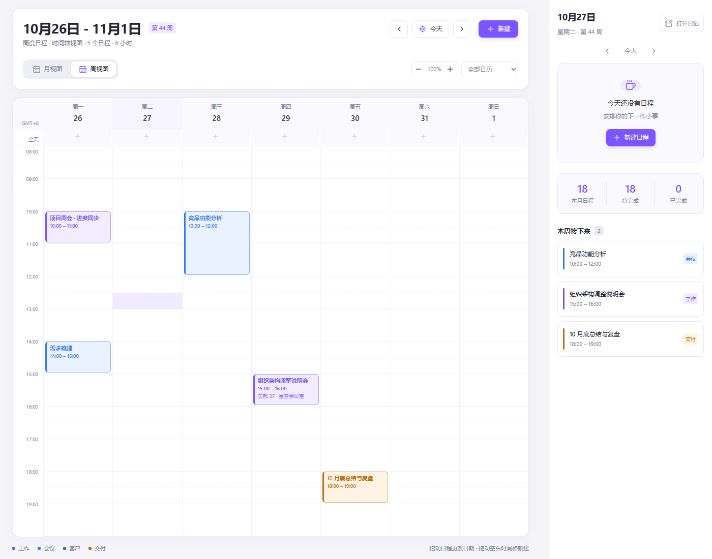
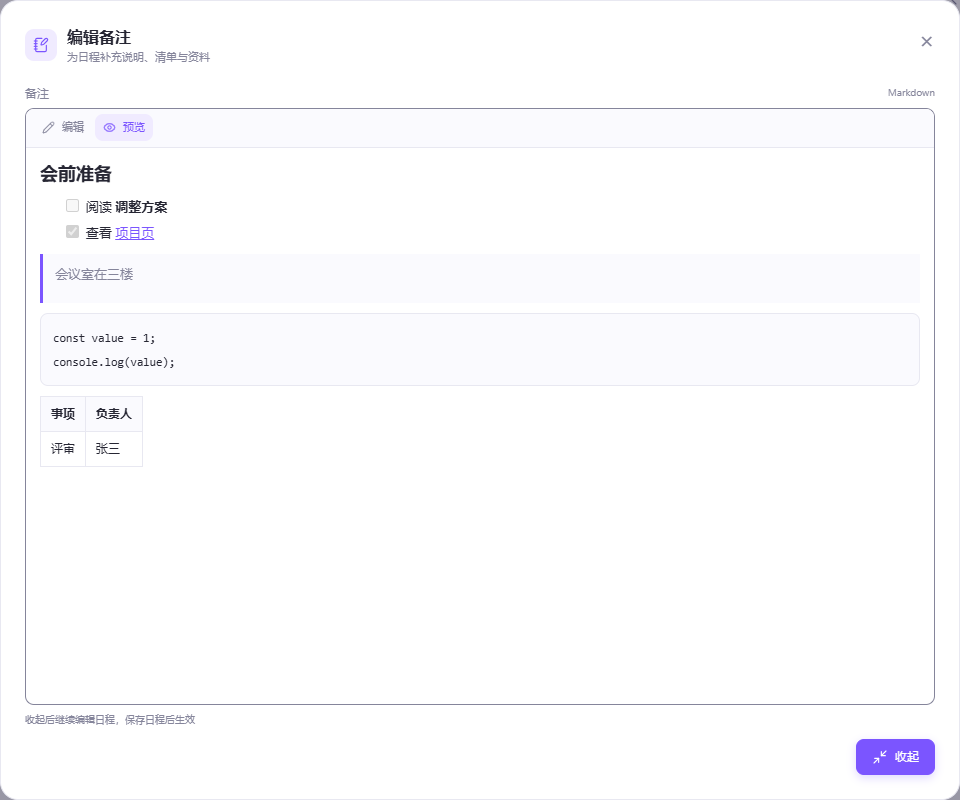

# Simple Days

A schedule manager for Obsidian with month and week calendars, Markdown event notes, and daily-note synchronization.

[中文说明](README.zh-CN.md)



## Features

- Open the calendar in a dedicated workspace tab and optionally show an overview in the sidebar.
- Create timed, all-day, and multi-day events. Filter by work, meeting, client, or delivery category.
- Move events to another date with desktop drag and drop while keeping their times and duration.
- Write Markdown notes with headings, checklists, links, tables, and code blocks. Expand the editor for longer notes.
- Check individual Markdown tasks directly in event details. Task status is independent of event completion.
- Sync events to the matching daily notes and open those notes from the calendar.
- Preview and import schedules from daily notes when only Markdown files were synced to another device.
- Use light and dark themes and responsive layouts.

The interface follows Obsidian’s language setting: Chinese for Chinese settings and English for English or currently unsupported languages. Dates, weekdays, categories, settings, commands, notices, and generated daily-note labels follow the same language. Reload Obsidian after changing its language. User-entered event content and configured note paths are preserved. The plugin requires Obsidian 1.7.2 or later. It uses Obsidian APIs and browser APIs, with no Node.js or Electron APIs at runtime.

## Installation

### Manual installation

1. Download `main.js`, `manifest.json`, and `styles.css` from the same version on the [Releases page](https://github.com/ChenXiaoW/simple-days/releases).
2. Create the folder `<vault>/.obsidian/plugins/simple-days/`.
3. Place the three files directly inside that folder.
4. Enable **Simple Days** in **Settings → Community plugins**. Reload Obsidian if needed.

To update, replace those three files and preserve your existing `data.json`.

You can also install or update **Simple Days** from Obsidian's community plugin directory.

An update does not require uninstalling the plugin. If Obsidian reports “Installation failed”, first retry after restarting the app. To update manually, disable the plugin, replace the three install files in its existing folder, and reopen Obsidian while keeping `data.json`. Do not enable both the old `obsidian-schedule-manager` prototype and Simple Days. A generic installation failure does not identify whether downloading, replacing files, or loading failed; it is not by itself evidence of incompatible schedule data.

### Migrating from the local prototype

Earlier local versions used the ID `obsidian-schedule-manager`. Simple Days uses the ID `simple-days` for public distribution.

1. Back up your vault, including `.obsidian/plugins/obsidian-schedule-manager/data.json`.
2. Disable the old plugin, then close Obsidian so it cannot write during the migration.
3. Install the three release files in `.obsidian/plugins/simple-days/`.
4. Copy the old plugin's `data.json` into the new folder. If Simple Days already has data, keep a separate backup of it before replacing the file; this step does not merge two datasets.
5. Reopen Obsidian and enable **Simple Days**. Check your events and daily-note settings before removing the old plugin.

Keep the old plugin disabled while using Simple Days. Both would otherwise update the same daily-note block. Existing daily-note markers and calendar view identifiers are retained for compatibility. Existing command hotkeys may need to be reassigned under Simple Days.

## Usage

- Click the calendar ribbon icon or run **Simple Days: Open schedule** to open the calendar.
- Switch between **Month** and **Week** in the toolbar.
- Select a day to see its agenda. Use **New event** to add an event, or double-click a blank month cell on desktop.
- Open an event to view, edit, duplicate, complete, or delete it, or to open its daily note.
- Use the overview button in the calendar tab header to open or close the sidebar schedule overview. Its label switches between **Open schedule overview** and **Close schedule overview**. The separate **Open schedule overview in sidebar** command opens it without toggling it closed.



### Date ranges and moving events

All-day events include their ending date. Timed events continue from their starting date and time through their ending date and time. An event ending at midnight does not occupy the ending day.

Desktop drag and drop moves an entire event, retaining its times and span. Dragging a continuation day aligns that day with the destination. Hover over the previous/next navigation arrow while dragging to move across calendar pages. Dropping on the week timeline changes the date; edit the event to change its time.

### Markdown notes

Use **Edit** / **Preview** to switch between Markdown source and preview. Drag the input's bottom-right handle on desktop to change its height, or select **Expand notes** to edit in a larger window. Closing the larger window keeps the draft in the event form; save the event to persist it.

Checklists in event details save immediately and update synchronized daily notes. Editor previews remain read-only. Internal links and attachments resolve relative to the vault root.



### Daily notes and data

Daily-note synchronization is enabled by default. The plugin reads the core Daily notes folder, date format, and template settings when available; otherwise it uses `日记/YYYY-MM-DD.md`. You can configure a different folder and date format in the plugin settings, or disable synchronization.

Automatic synchronization runs **calendar → daily note**. Editing a daily note does not automatically update the calendar, and a later sync replaces the generated block. Explicit recovery from these blocks is available through the importer below. Your text outside these markers is preserved:

```markdown
<!-- obsidian-schedule-manager:start -->
## 日程
...
<!-- obsidian-schedule-manager:end -->
```

The legacy marker names are intentional. Moving, shortening, completing, or deleting an event also updates its earlier daily-note entries. Empty daily-note files are kept. If synchronization fails, the saved event remains available and the plugin shows a notice so you can retry.

All schedules and settings are stored locally in `<vault>/.obsidian/plugins/simple-days/data.json`. Include that file in your backups. The plugin does not send schedule data to a server and does not collect telemetry. Markdown notes may contain remote images or other embeds, which can contact their hosts when rendered.

## Syncing between devices

For full device synchronization, include `.obsidian/plugins/simple-days/data.json`. It holds schedules, Markdown notes, completion states, categories, and settings. Some sync tools exclude hidden folders or plugin data by default. Use the same plugin ID and version on each device. If you only synced daily Markdown files, use the importer to recover schedules explicitly.

External data changes refresh the calendar and sidebar automatically. Returning to Obsidian or opening a calendar checks for updates. Mobile also checks every 15 seconds while the app is visible and a calendar or overview is open. After a pull, you can run **Simple Days: Reload schedules from disk** to check immediately.

Reloading reads and validates one complete snapshot without writing it back or updating daily notes. A missing, incomplete, or invalid file keeps the currently loaded data and shows a notice. This does not provide field-by-field merging for simultaneous edits on different devices; finish syncing before editing on another device.

### Import / rebuild from daily notes

1. Finish pulling your daily Markdown files to the device.
2. Run **Simple Days: Import / rebuild schedules from daily notes**, or select **Daily notes → calendar → Scan and import** in the plugin settings.
3. Select **Scan daily notes**. Review the new schedules, duplicate count, and skipped entries.
4. Select **Import new schedules** to save them to the calendar and sidebar.

Scanning and importing leave diary files unchanged. Existing schedules are preserved; importing the same entries again does not create duplicates. Both legacy Chinese and English schedule blocks are supported. Dates, complete multi-day ranges, times, completion state, location, tags, participants, and Markdown notes are recovered. Repeated occurrences across multiple daily notes are merged. Categories and original IDs are absent from the old diary format, so restored events receive new IDs and the Work category. The importer scans all Markdown files with the plugin's markers, including notes moved to another folder; ordinary checklists are ignored.

Dates come from explicit `### YYYY-MM-DD` headings, complete multi-day ranges, the configured Daily notes filename format, or an ISO `YYYY-MM-DD.md` filename. For custom nested formats, check the Daily notes folder and format settings. Files named only by month need explicit day headings for single-day entries; the importer never guesses a missing day. Conflicting copies and unreadable entries are listed and skipped. Recovery adds missing schedules; it does not update or delete existing ones or establish automatic two-way synchronization. Complete recovery before editing schedules or running a diary sync, as normal synchronization replaces generated blocks. Back up `data.json` for a complete copy including categories and settings.

The separate **Calendar → daily notes → Write to daily notes** action writes the calendar into notes. It reports the number of updated files and up to three actual output paths. Already matching content reports zero updates. With an empty calendar and no tracked note paths, this action opens the importer instead of reporting an empty sync as success.

## Mobile support and limitations

The plugin is enabled for mobile and has responsive layouts and touch creation/editing. Desktop drag and drop and textarea resizing are not promised on touch devices; edit the dates or use the expanded notes editor instead. Android and iOS device testing is still pending; existing automated checks use API mocks and browser touch emulation.

Reminders, recurrence, and calendar-service integration are not implemented.

## Development

Use Node.js 22 and npm:

```sh
npm ci
npm run typecheck
npm run build
npm test
npm run check:release
```

The TypeScript files are bundled into `main.js`. Obsidian provides the runtime API. The tests use Obsidian API mocks; they do not replace testing in a real vault.

Starting with 0.6.4, the release workflow generates and verifies GitHub build provenance attestations for all three install files. To verify a downloaded file yourself, use `gh attestation verify main.js --repo ChenXiaoW/simple-days` (replace the filename to check the other assets).

See [Releasing](RELEASING.md) for the GitHub release and community directory submission steps, and [Changelog](CHANGELOG.md) for version history.

## License

[MIT](LICENSE) © ChenXiaoW.
